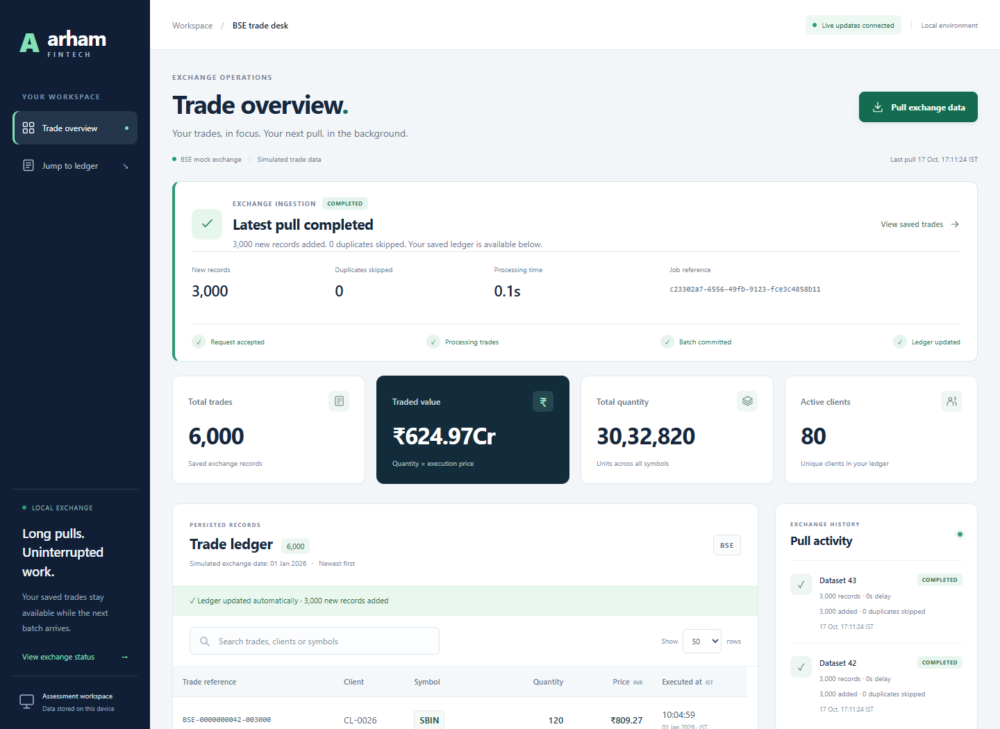

# Arham Trade Desk

A local trade ingestion dashboard for the **Arham Fintech Software Engineer Technical Assessment**. A separate worker processes slow mock BSE pulls while the dashboard keeps serving saved trades. Committed batches appear automatically through WebSocket notifications.

**No paid services, API keys, credit card, cloud account, or frontend build required.** The application works offline after dependencies are installed. The optional Swagger viewer uses CDN assets; `/openapi.json` remains available offline.



## Functionality and stack

- Responsive dashboard with searchable, paginated trades, INR aggregates, and ingestion history.
- Immediate `202 Accepted`, durable job IDs, visible running/completed/failed states, and elapsed time.
- Deterministic mock data, atomic insertion, duplicate prevention, restart recovery, and reconnect replay.
- **Python 3.11+**, FastAPI, Pydantic, Uvicorn, SQLite WAL, a separate Python worker, and native HTML/CSS/JavaScript with WebSocket. Node.js/Playwright are optional test tools.

See the [architecture note and Mermaid diagram](docs/ARCHITECTURE.md) for the design and timeout assumptions.

## Setup and run

Requires Git, Python 3.11 or newer, and a modern browser. Verified with Python 3.13 on Windows.

```powershell
git clone https://github.com/Trunal2005/Arham.git
cd Arham
python -m venv .venv
.\.venv\Scripts\python.exe -m pip install -r requirements-dev.txt
.\.venv\Scripts\python.exe -m uvicorn arham.app:app --host 127.0.0.1 --port 8000
```

Open **http://127.0.0.1:8000**. API documentation: **http://127.0.0.1:8000/docs**. After setup, `./run.ps1` is a convenience launcher. Runtime-only dependencies are in `requirements.txt`.

On macOS/Linux, create the environment with `python3 -m venv .venv` and use `.venv/bin/python` in the remaining commands. Stop with Ctrl+C; rerun Uvicorn to restart. Do not pass `--workers`: one API process owns each database and its worker.

SQLite data is created in `data/trades.sqlite3`, excluded from Git. Set `ARHAM_DB` to use another database. A fresh clone starts with an empty ledger; create records through the pull dialog.

## Demonstrate the 30-second problem

1. Open the dashboard in two tabs. Choose **Pull exchange data**, select a 5-second delay, 3,000 records, and seed 42. Both tabs update automatically after completion.
2. Open browser Network tools. Start another pull with a **32-second delay**, 3,000 records, and seed 43. `/getTrades` returns **202** promptly with `job_id` and a `Location` result URL.
3. Search and paginate the existing ledger during the wait. The active panel shows job ID, configured delay, elapsed time, and state. After more than 30 seconds, both tabs receive the completion and update without reloading.
4. Repeat seed 43 with the same count: existing trade IDs are skipped. Choose **900 seconds** to configure a full 15-minute simulated delay if desired.

The worker waits **locally**; it does not hold a slow upstream HTTP connection. Moving a real remote request into a worker would not bypass that upstream's 30-second timeout. A real provider would need an asynchronous/callback or resumable protocol, or a suitable network route. The independent `/mock-bse/getTrades` route demonstrates a literal delayed HTTP response and can still time out behind the stipulated cutoff.

## HTTP and automatic updates

| Route | Purpose |
|---|---|
| `GET /getTrades?delay_seconds=32&record_count=3000&seed=43` | Accept a pull; return `202` and a job ID. |
| `GET /getTrades?job_id=<id>` | `202` while active; `200` with generated data when complete. |
| `POST /api/pulls` | Alternative command with JSON `delay_seconds`, `record_count`, `seed`. |
| `GET /api/pulls` / `GET /api/pulls/<id>` | Recent jobs / individual durable status. |
| `GET /api/dashboard` | Consistent trade page, aggregates, and jobs. Supports `search`, `limit`, `offset`. |
| `GET /api/trades` / `GET /api/summary` | Separate ledger and aggregate reads. |
| `GET /api/health` | Database and worker health; `503` when degraded. |
| `WS /ws?after=<event_id>` | Durable replay followed by live job events. |

The worker commits trades, job completion, and the event atomically, then notifies FastAPI through a pipe. An event-driven dispatcher sends ordered WebSocket events. The browser fetches one snapshot after relevant events or reconnects, preserving search and pagination. **There is no periodic HTTP polling, cron, or scheduler.** The elapsed-time clock is a local display.

Delays accept 0–900 seconds; counts 1–10,000; seeds 0–2,147,483,647. Concurrent pulls return `409`, invalid input `422`, and unknown jobs `404`.

## Tests and evidence

```powershell
.\.venv\Scripts\python.exe -m pytest -q
# Optional faster subset:
.\.venv\Scripts\python.exe -m pytest -q -m 'not slow'
```

The backend suite contains **22 tests**, including two actual 32-second runs, real API/worker subprocesses, two-subscriber WebSocket delivery, rollback, duplicate prevention, concurrent acceptance, replay, and restart recovery. Allow about two minutes.

Optional browser checks require Node.js:

```powershell
npm ci
npx playwright install chromium
npm run test:e2e
```

The browser suite performs **16 checks**, including delayed ingestion, two tabs, responsive layouts, replay, worker failure, and server restart. It owns an isolated database/server and takes about 90 seconds. To use an installed browser, set `BROWSER_EXECUTABLE` to its executable and install the recording helper with `npx playwright install ffmpeg`. `PYTHON_EXECUTABLE` can select another Python environment.

Results: [submission verification](docs/SUBMISSION.md), [detailed verification](docs/VERIFICATION.md), and [UI before/after evidence](docs/UI_REDESIGN.md). Browser tests replace their reproducible evidence under `docs/evidence/`; temporary databases, logs, and browser caches stay ignored under `test-results/`.

## Video walkthrough

[Watch or download the narrated walkthrough](docs/evidence/submission-walkthrough.mp4) · [captions](docs/evidence/submission-walkthrough.vtt) · [walkthrough guide](docs/WALKTHROUGH.md).

The video uses a disclosed local synthetic voice and an actual application recording. It demonstrates the real 32-second wait, saved records, background ingestion, live updates, duplicates, and architecture. The 900-second option is configuration evidence; no full 15-minute completion is claimed.

## Boundaries

This assessment uses a **mock provider**, not a real BSE integration. Prices use integer paise; mock execution dates are 1 January 2026 and display in IST. Job times reflect actual processing. One worker processes one pull at a time. Restart repeats interrupted work from the beginning; unexpected worker exit produces a visible failure and the next explicit pull starts a replacement.

Bind locally as shown. Authentication, TLS, multiple hosts, distributed queues, and production brokerage controls are outside this assessment. See [assessment compliance](docs/COMPLIANCE.md) and the [architecture note](docs/ARCHITECTURE.md).
