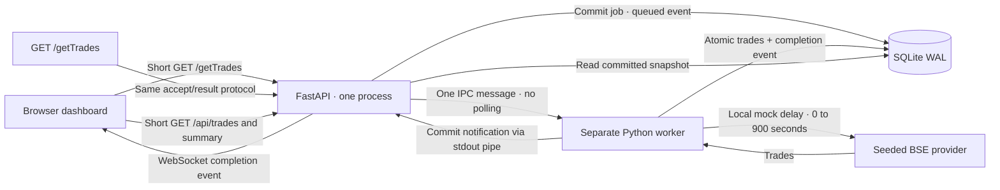

# Architecture note

## Data and control flow



```mermaid
sequenceDiagram
    participant B as Browser
    participant A as API
    participant D as SQLite
    participant W as Worker process
    B->>A: Subscribe WS /ws?after=cursor
    A->>B: Durable replay, then connected
    B->>A: GET /getTrades with pull configuration
    A->>D: INSERT queued job and event
    A->>B: WS pull.queued
    A->>W: IPC job ID
    A-->>B: 202 Accepted + Location
    W->>D: Mark running, append started event
    W->>A: IPC started event ID
    A->>B: WS pull.started
    Note over W: Wait up to 15 minutes locally; no open HTTP request
    B->>A: Read/search/page cached trades
    A->>D: SELECT committed trades
    A-->>B: Existing ledger immediately
    W->>D: Single transaction: INSERT OR IGNORE trades, complete job, append event
    W->>A: IPC completion event ID after commit
    A->>B: WS pull.completed
    B->>A: Fetch updated ledger and summary once
    A-->>B: New committed trades
```

## Why this design

The dashboard must outlive a slow exchange pull without inheriting the exchange's delay. Returning an accepted job immediately separates request lifetime from processing lifetime. All processing waits occur in a separate process. SQLite WAL permits reads of existing committed data while a batch writes; no partial batch is exposed. IDs based on seed and record index make retries idempotent, with a database primary key as the final duplicate guard. Integer paise avoids accumulating floating-point price errors in financial aggregates.

The worker blocks on its stdin pipe until the API supplies a job. The API awaits worker stdout for commit notifications, then broadcasts WebSocket events. No cron, scheduler, database scan interval, frontend polling loop, paid queue, or hosted pub/sub is needed. OS pipe backpressure is bounded by tiny event messages, not thousands of trade rows. Worker work survives the HTTP response because it is owned by the server lifecycle.

Jobs, trade rows, and the durable event log live in one SQLite database. Completion state and the corresponding event are written in the same transaction as trades. If insertion fails, the entire batch rolls back and a separate transaction records failure. On server startup, an interrupted `running` job returns to `queued` and is sent to the replacement worker. The restarted attempt repeats the mock delay; no estimate of partially elapsed time is claimed.

Subscribers replay all events after their cursor while holding the broadcast-registration lock, then join the live set. This prevents a completion occurring between history replay and registration from being lost. A browser also fetches a snapshot on every successful connection, so a page reload or reconnect reconciles current database state. Live IDs can be delivered again around replay; clients ignore duplicates. Individual slow WebSocket sends have a timeout and are disconnected so reconnect/replay can recover them. This is at-least-once event delivery, not exactly-once network delivery.

## Tradeoffs and failure handling

| Failure or constraint | Behavior |
|---|---|
| HTTP connection cutoff at 30 seconds | Accept and read endpoints return promptly; delay occurs outside HTTP. |
| Another pull requested while one runs | SQLite partial unique index rejects it; caller receives 409 and the active job ID. |
| Network/WebSocket disconnect | Exponential reconnect backoff, durable replay cursor, then current snapshot. No HTTP polling. |
| Duplicate dataset | `INSERT OR IGNORE` skips identical IDs; completed pull records actual inserted count. |
| Database failure mid-batch | Atomic rollback; failed job and event; retry after fixing the cause. |
| API/server process dies during work | Restart requeues interrupted work; committed trades remain. |
| Worker exits unexpectedly | Active jobs fail visibly; next explicit pull starts a replacement worker. |
| Subscriber is too slow | Send timeout, disconnect, cursor replay on reconnect. |
| Multiple API instances sharing one database | Unsupported; each API must own its own DB/worker/hub. |

The asynchronous `/getTrades` contract is intentional: a conventional HTTP endpoint that withholds its response for 15 minutes cannot meet a universal 30-second HTTP lifetime limit. The mock exposes a job result URL and final seeded records instead. The dashboard's named mock route and the alternative explicit POST command enter the same ingestion pipeline.

No external service is required. Production scaling would replace process-local IPC with a durable broker and shared event distribution, plus a multi-writer database; that additional infrastructure is unnecessary for this local assessment.
