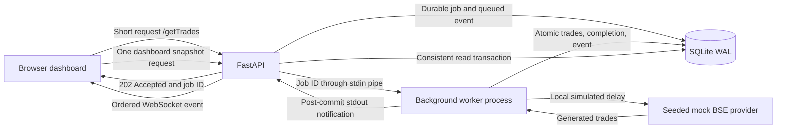

# Architecture note

## Problem

An exchange pull may take 15 minutes, while ordinary HTTP requests are limited to 30 seconds. Users must continue reading saved trades and receive new records automatically. The solution separates short requests, background processing, persistent state, and live notification.

## Components and flow

- **FastAPI (`arham/app.py`)** serves the dashboard, validates requests, persists a queued job, and promptly returns `202` plus its ID and `Location`. `/getTrades?job_id=...` exposes the eventual result. `POST /api/pulls` enters the same pipeline.
- **Background worker (`arham/worker.py`)** runs in a separate process. It blocks on stdin until a job arrives, waits for the configured local delay, and calls the provider. Its lifetime belongs to the server rather than the initiating HTTP client.
- **Mock BSE provider (`arham/provider.py`)** generates reproducible records from a seed. The independent `/mock-bse/getTrades` demonstration waits and returns records directly without ingestion; the worker does not call it over HTTP.
- **SQLite (`arham/db.py`)** stores jobs, trades, and durable events. WAL permits committed-data reads during ingestion. One transaction inserts the batch, completes the job, and appends its event. `/api/dashboard` reads trades, aggregates, and jobs in a consistent snapshot. Prices use integer paise.
- **WebSocket (`/ws`)** carries queued, started, completed, and failed events. After commit, worker stdout wakes an ordered event dispatcher. The browser fetches a fresh snapshot on relevant events, preserving filters and pagination. Elapsed-time rendering performs no HTTP requests.

## Timeout interpretation

The accepted-job protocol ends the browser request promptly, so a **32-second local processing delay** can finish after the stipulated HTTP limit. Configuration supports 900 seconds; automated elapsed-time tests use 32 seconds.

Moving a real slow upstream HTTP request into a worker protects the browser request's lifetime but **does not bypass the upstream network timeout**. Here, the delay and provider execute locally. A real exchange behind a universal 30-second cutoff would need asynchronous job IDs/callbacks, resumable short requests, or an approved network route with sufficient timeout. The direct mock HTTP route can still time out behind that cutoff.

## Why no polling or cron

Work starts when a user submits a job. The worker blocks on its pipe; FastAPI awaits worker output. Producer signals wake the dispatcher, which drains durable events in ID order. Clients reconnect with their last event cursor and reconcile a current snapshot. No scheduled scans, database polling interval, or repeated browser status requests are needed.

## Recovery and duplicate prevention

Trade IDs derived from seed/index are primary keys; `INSERT OR IGNORE` makes retries idempotent. A partial unique index permits only one active pull. Failed batches roll back before a separate failure event is recorded. Completion remains authoritative once committed, even if its IPC notification fails.

On server restart, interrupted jobs are requeued and repeat their simulated delay. Unexpected worker exit visibly fails active jobs; the next explicit pull starts a replacement. Replay and subscription registration share a lock to avoid gaps; subscriber cursors prevent duplicate delivery during dispatch. Slow subscribers time out without delaying HTTP acceptance. Reconnect replay provides recovery, not exactly-once network delivery.

## Assumptions and limitations

One API process owns one worker and database, enforced by an OS-held lock. This local, zero-service-cost assessment has no real exchange connection, distributed queue, authentication, or public deployment. Proxies must allow WebSocket upgrades. Multi-host operation would require shared event distribution and different persistence/ownership choices. Mock execution dates are fixed examples; job timestamps are actual UTC times displayed in IST.
