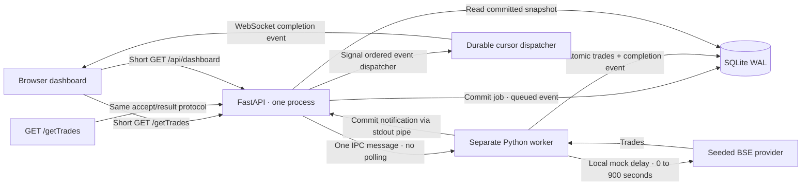

# Architecture note

## Data and control flow



```mermaid
sequenceDiagram
    participant B as Browser
    participant A as API
    participant D as SQLite
    participant W as Worker process
    B->>A: Subscribe WS /ws?after=cursor
    A->>B: Durable replay, then connected
    B->>A: GET /getTrades with pull configuration
    A->>D: INSERT queued job and event
    A->>A: Signal ordered dispatcher (do not await subscribers)
    A->>W: IPC job ID
    A-->>B: 202 Accepted + Location
    A-->>B: WS pull.queued (independent of response timing)
    W->>D: Mark running, append started event
    W->>A: IPC started event ID
    A->>B: WS pull.started
    Note over W: Wait up to 15 minutes locally; no open HTTP request
    B->>A: Read/search/page cached trades
    A->>D: SELECT committed trades
    A-->>B: Existing ledger immediately
    W->>D: Single transaction: INSERT OR IGNORE trades, complete job, append event
    W->>A: IPC completion event ID after commit
    A->>B: WS pull.completed
    B->>A: Fetch one consistent dashboard snapshot
    A-->>B: New committed trades
```

## Why this design

The dashboard must outlive a slow exchange pull without inheriting the exchange's delay. Returning an accepted job immediately separates request lifetime from processing lifetime. All processing waits occur in a separate process. SQLite WAL permits reads of existing committed data while a batch writes; no partial batch is exposed. IDs based on seed and record index make retries idempotent, with a database primary key as the final duplicate guard. Integer paise avoids accumulating floating-point price errors in financial aggregates.

The worker blocks on its stdin pipe until the API supplies a job. The API awaits worker stdout for commit notifications, then broadcasts WebSocket events. No cron, scheduler, database scan interval, frontend polling loop, paid queue, or hosted pub/sub is needed. OS pipe backpressure is bounded by tiny event messages, not thousands of trade rows. Worker work survives the HTTP response because it is owned by the server lifecycle.

Jobs, trade rows, and the durable event log live in one SQLite database. Completion state and the corresponding event are written in the same transaction as trades. If insertion fails, the entire batch rolls back and a separate transaction records failure. On server startup, an interrupted `running` job returns to `queued` and is sent to the replacement worker. The restarted attempt repeats the mock delay; no estimate of partially elapsed time is claimed.

Subscribers replay all events after their cursor while holding the broadcast-registration lock, then join the live set with a delivered cursor. A single dispatcher drains the event log in ID order whenever an `asyncio.Event` is signalled by a producer. A newly accepted job therefore cannot overtake the prior completion event. There is no timed scan or polling interval. Individual slow sends have a timeout; HTTP acceptance never waits for subscribers.

A browser fetches a snapshot on every successful connection. The new `/api/dashboard` endpoint reads trades, aggregates, and recent jobs within one explicit read transaction, preventing mixed pre/post-commit counts. Page/search state and table scroll remain intact during automatic updates. Replay is reconciled once, with no stale completion toasts. The server clamps impossible future cursors after a local database restore and the connected acknowledgment resets the client's cursor. Clients still ignore duplicate event IDs. This is recovery-oriented at-least-once delivery, not exactly-once network delivery.

## Tradeoffs and failure handling

| Failure or constraint | Behavior |
|---|---|
| HTTP connection cutoff at 30 seconds | Accept and read endpoints return promptly; delay occurs outside HTTP. |
| Another pull requested while one runs | SQLite partial unique index rejects it; caller receives 409 and the active job ID. |
| Network/WebSocket disconnect | Exponential reconnect backoff, durable replay cursor, then current snapshot. No HTTP polling. |
| Duplicate dataset | `INSERT OR IGNORE` skips identical IDs; completed pull records actual inserted count. |
| Database failure mid-batch | Atomic rollback; failed job and event; retry after fixing the cause. |
| API/server process dies during work | Restart requeues interrupted work; committed trades remain. |
| Worker exits unexpectedly | Active jobs fail visibly; next explicit pull starts a replacement worker. |
| Subscriber is too slow | Send timeout, disconnect, cursor replay on reconnect. |
| Multiple API instances sharing one database | Second startup fails before mutating job state; an OS lock enforces one API owner. |

The asynchronous `/getTrades` contract is intentional: a conventional HTTP endpoint that withholds its response for 15 minutes cannot meet a universal 30-second HTTP lifetime limit. The mock exposes a job result URL and final seeded records instead. The dashboard's named mock route and the alternative explicit POST command enter the same ingestion pipeline.

No external service is required. Production scaling would replace process-local IPC with a durable broker and shared event distribution, plus a multi-writer database; that additional infrastructure is unnecessary for this local assessment.

## Literal provider behavior and timeout assumptions

There is one authoritative `generate_trades(seed, count)` function. The worker consumes it locally after the simulated processing delay. `/mock-bse/getTrades` is a clearly separated direct provider demonstration: it waits for its configurable delay, then returns 200 with generated trades, without creating an ingestion job or inserting rows. It demonstrates the literal delayed-data behavior under a distinct prefix; it does not contradict the named `/getTrades` orchestration contract.

The original literal endpoint interpretation is “wait up to 15 minutes, then return trades.” The dashboard-facing interpretation is “accept immediately, process independently, then expose the completed result and push a notification.” A 15-minute response cannot traverse a universal 30-second HTTP lifetime cutoff. Moving the exact same blocked remote HTTP request into a worker would protect the browser request lifetime but would **not** bypass the worker's upstream network timeout.

In this local mock, the worker does not issue a long network request at all: the delay is local and the seeded generator is an adapter within the worker process. Its processing lifetime is owned by the server, rather than an HTTP client. The direct provider endpoint is only a demonstration, so delays at or above 30 seconds can still fail behind the stipulated network device. It is deliberately not used as a long HTTP call by the worker.

If a real upstream BSE API itself is cut off after 30 seconds, successful ingestion would require upstream support for asynchronous job IDs with callbacks/push, resumable cursors, short page/chunk requests, or an approved network route with an adequate timeout. If none exists, a worker alone cannot satisfy that upstream constraint. This project makes no claim to solve an impossible upstream protocol.

## Timing and process lifecycle

`ARHAM_TRACE` enables local JSONL milestones: HTTP accepted, worker started, worker finished its transactional work, DB commit completion observed after commit/connection close, and successful WebSocket send. Successful send means the transport accepted the frame, not a browser acknowledgment. Tests separately timestamp actual socket receipt. Browser DOM checkpoints use a separate `performance.now()` clock and report receipt-to-render durations within each document. Server and browser absolute clock values are never subtracted.

Graceful shutdown terminates the worker and waits with a bounded timeout before killing a stuck process. Interrupted active work remains recoverable on restart. Failure of IPC after a committed batch no longer rewrites the job as failed: durable completion remains authoritative, and the server closes subscriptions to trigger replay/snapshot recovery after an unexpected worker exit. Database ownership is held with an OS file lock throughout application lifespan.
